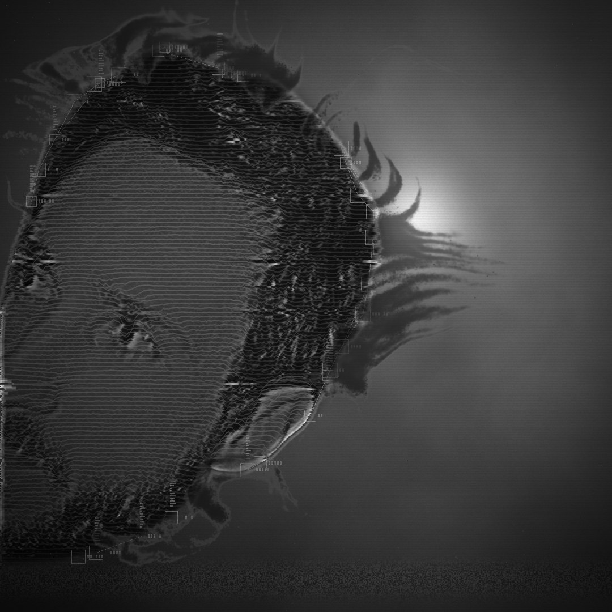

# Artist photo loop: Screen 2 silhouette + Ambient Ink with vibration

`artist_head_ink_loop.mp4` is a **7 s seamless loop** (1080 × 1080, 30 fps, H.264) built from `artist_photo.jpg`.
Only the head is used; the room, the neck and the hoodie are removed (`head_mask.png`).



**What's in it**

- **Screen 2 silhouette** (`Screen2/screen2.glsl`): the head is a dark, backlit form against one soft light far behind
  drifting haze. The haze flows round the head and its outline catches the light. The face is drawn as scan lines
  lifted by the photo (analog video synth), with the photo's relief catching a little light. Older heads drift behind
  it as ghosts, and the rows come from slightly different moments (time slicing). The analog-TV layer is on as well:
  a tracking band rolls down once per loop, plus sync wobble, a vertical-hold slip, snow, dropouts, interlace and
  scanlines. The tracking overlay locks boxes and data bars onto the outline.
- **Ambient Ink particles** (`Ambient Ink Live/ink_*.glsl`): about 320k ink particles well up from about 56 points on
  the head's outline. The flow (curl-noise billows, a current away from the face, buoyancy) stretches them into
  tendrils. The ink spreads and pales as it ages, with trails and a dissolved halo, and is laid over the picture with
  `ink_layer`'s greys.
- **Vibration** (`ink_post.glsl`): the ink trembles all the time. At 1.55 s and 4.85 s it erupts in puffs and shakes
  hard: per-frame jitter, a fast oscillation, rows wobbling, and a faint second image trailing the shake. The Screen 2
  glitches peak on the same beats.

Every time-dependent term is periodic in the loop length, so the end runs straight into the start.

## Hologram in the stream (latest)

`artist_head_hologram_loop.mp4` (made by `render_hologram_loop.py`) is a 7 s, 1080 × 1080 seamless loop.

- A particle stream constantly flows across the whole frame from the left side to the right side, with curl-noise
  swirls.
- Most of the time there is only the flow. The face appears only now and then (`APPEAR`), gradually and subtly. It
  thickens out of the stream over about 1.4 s (eased in, in soft patches), lingers, and dissolves back over about
  1.8 s. The first appearance peaks around the 1.55 s burst; the second, fainter one peaks around 4.85 s. Even at the
  peak the stream keeps running through the face. The flow gathers in the head only while it is there.
- The head is hidden inside it, drawn the way Screen 2 draws its figure: a dark form in the light, with a soft outline
  catching the light. There are no traced features, only a faint soft relief inside. The outline wobbles and breathes
  as the haze flows round it, breaks into bright segments that travel along it, tears sideways now and then, and
  leaves two faint older outlines trailing behind. The stream particles draw all of it, and a thin layer of the head's
  own particles keeps evaporating into the flow.
- Hologram look: additive glowing particles with bloom on dark, projection scanlines, a bright scan band rolling up
  twice per loop, flicker, slices glitching sideways, an RGB fringe and a faint cool tint (`Tint = (1, 1, 1)` for
  grey).
- At 1.55 s and 4.85 s a gust drives the flow, the slices and RGB split peak, and the Ambient Ink vibration shakes
  the light.

The look is set in the `LOOK` dict at the top of the script. Streamglow, Figure, Rim, Flow, Tear, Echoes, Detail and
Headdensity set how the head shows, `APPEAR` (start time, strength) sets when it surfaces, and `RISE`, `HOLD` and `FALL` set how slowly. Gain, Bloom, Scanlines, Scanband, Flicker, Slices, Chroma and Tint set the hologram.

```
python ArtistPhoto/render_hologram_loop.py                  # -> ArtistPhoto/artist_head_hologram_loop.mp4 (~5 min, ~3 GB RAM)
python ArtistPhoto/render_hologram_loop.py --preview 30 52  # a few PNGs only
```

## Evaporating silhouette

`artist_head_silhouette_evaporate_loop.mp4` is a 7 s, 1080 × 1080 seamless loop made by `render_evaporate_loop.py`
(the default `--look silhouette`).

- The head is a dark form against the backlight, built from about 1.5M noise particles.
- The face is concealed. Only contours show: the outline catches the light as a grainy rim, and faint lines trace the
  hairline, eyes, brow, ear and beard edge (from the photo's edges).
- The whole head constantly evaporates to the right. Each grain rests and trembles, then lifts off on a current that
  speeds up, and turbulence and buoyancy tear the streams into dark smoke. The back of the head goes first.
- At 1.55 s and 4.85 s a gust drives the streams and the Ambient Ink vibration (`ink_post.glsl`) shakes the whole
  particle head.
- Behind it are the Screen 2 haze, the rolling tracking band, snow, dropouts, scanlines and the vignette.

`artist_head_evaporate_loop.mp4` is the earlier photo-tone version (`--look photo`): the particles take the photo's
tones, so the portrait itself is visible.

The look is set in the `PP` dict: Hold, Flight, Current, Rise, Turbulence, Coverage, Shimmer, Tremble, Rim, Contours,
Dust and Vibration. `--density` sets how many particles there are.

```
python ArtistPhoto/render_evaporate_loop.py                  # silhouette -> ArtistPhoto/artist_head_silhouette_evaporate_loop.mp4 (~5 min, ~3 GB RAM)
python ArtistPhoto/render_evaporate_loop.py --look photo     # photo tones -> ArtistPhoto/artist_head_evaporate_loop.mp4
python ArtistPhoto/render_evaporate_loop.py --preview 30 52  # a few PNGs only
```

## Re-render

```
pip install numpy opencv-python-headless
python ArtistPhoto/render_artist_loop.py                     # -> ArtistPhoto/artist_head_ink_loop.mp4 (~3 min on 4 cores)
python ArtistPhoto/render_artist_loop.py --preview 0 52 150  # a few PNGs only, to try settings
python ArtistPhoto/render_artist_loop.py --seconds 5 --size 720 --out short.mp4
```

The look is set in the `P2` dict (the Screen 2 page values) and the `PI` dict (the Ambient Ink and layer values) at
the top of the script. `BURSTS` holds the moments when the ink erupts and the vibration peaks. ffmpeg must be on the PATH.

This is an offline port of the shaders (numpy / OpenCV), not a TouchDesigner render. TouchDesigner isn't available
where this was made.

The head mask came from BiRefNet-portrait (rembg), then a cut under the beard removed the neck and hoodie.
